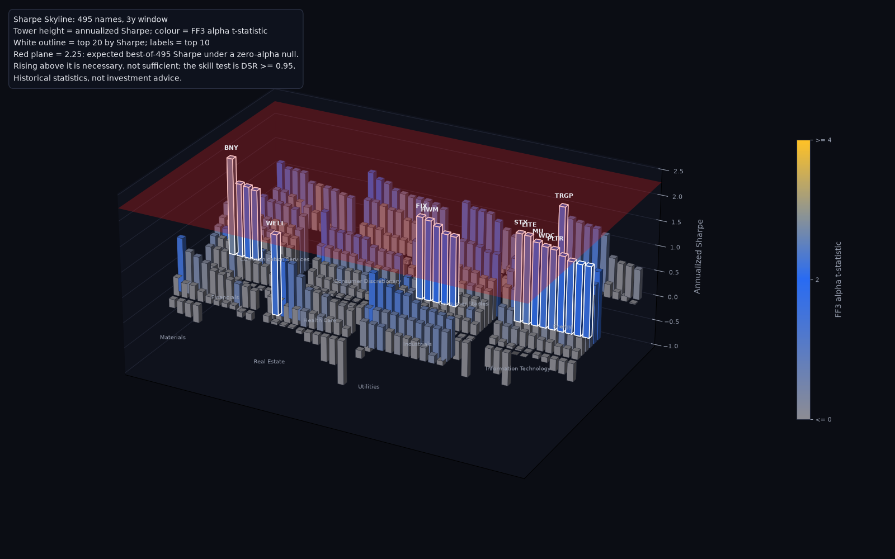
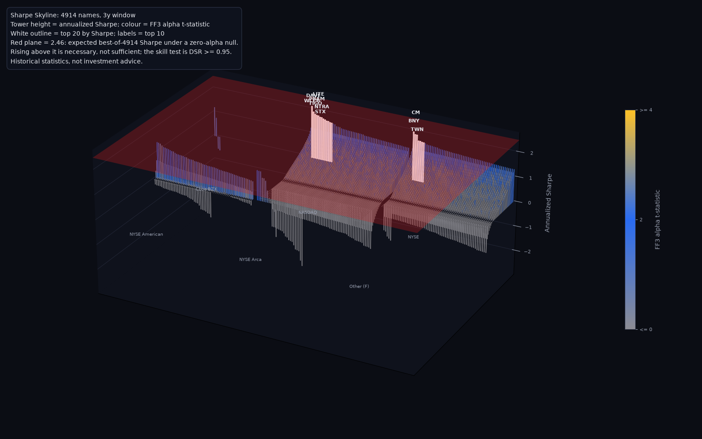

# Sharpe Observatory

A Claude Code plugin that screens a stock universe by Sharpe ratio and Jensen's alpha, corrects the screen for luck, and renders the result as a 3D skyline: a PNG (matplotlib, or Blender when available), a live Blender scene, or a three.js page in the browser.


*The bundled synthetic sample, rendered headless with matplotlib (`scripts/scene_python.py`). Run `render_skyline.py --html --open` for the interactive three.js version.*

## What it does

- **Screens** every name over a trailing window (1, 3 or 5 years) by annualized Sharpe ratio, and estimates CAPM and Fama-French 3 alphas with classic OLS t-statistics.
- **Corrects for luck** with the Probabilistic Sharpe Ratio, the expected maximum Sharpe ratio across N trials, and the Deflated Sharpe Ratio.
- **Reports** a ranked top-20 table (`out/report.md`) and a machine-readable result (`out/screen_result.json`).
- **Visualizes** the screen as a skyline: one tower per stock, grouped by sector, height = Sharpe, colour = alpha t-statistic, the top 20 glowing, and a red plane at the expected best-of-N Sharpe. Output is a self-contained Blender script with the data embedded (`out/skyline_bpy.py`), a PNG rendered headless with no installation (`out/skyline.png`, matplotlib by default, Blender when available), or an interactive single-file page that loads three.js from the jsdelivr CDN (`out/skyline.html`). The page opens with a verdict strip (names screened, how many of the top 20 pass DSR >= 0.95, the luck plane's value) and a one-line plain-English verdict. Drag the floor to move like a map, drag the sky to orbit, scroll to zoom, double-click any bar to fly to it, and press R to reset the view. You can click any tower, a row of the top-20 list, or search any ticker to see its rank, Sharpe in every window, CAPM and FF3 alpha, PSR, DSR and days of data, copy the row as JSON, or follow links to Google Finance, SEC EDGAR (sec.gov) and the company website. Esc closes the details. The scene also shows a labelled Sharpe 0 level, the luck plane's value, a value ruler and a floor tint per sector.

It ships two skills: `sharpe-screen` (run and explain the screen) and `sharpe-skyline` (build the 3D scene).

## The luck correction, in one paragraph

If you rank 500 stocks by Sharpe ratio, the winner looks impressive even if no stock had any real edge, because the best of 500 noisy estimates is far above the typical one. The False Strategy Theorem (Bailey, Borwein, López de Prado & Zhu 2014; López de Prado 2020, *Machine Learning for Asset Managers*, ch. 8 and App. B) gives the Sharpe ratio the best of N trials is expected to reach when none has an edge: E[max SR] = E[SR] + sqrt(V[SR]) x ((1 - g) Z(1 - 1/N) + g Z(1 - 1/(N e))), with g the Euler-Mascheroni constant and Z the standard-normal quantile. Here the null gives every name the universe's average Sharpe (a zero-alpha null), and V[SR] is the larger of two estimates: the spread of Sharpe ratios observed across the universe, and the textbook sampling variance (1 + SR^2/2)/n. Taking the larger is the more conservative of those two estimates, and nothing stronger is claimed. That expected maximum is drawn as the **luck plane**. A name's **Deflated Sharpe Ratio** (DSR) is the probability, allowing for its sample length, skewness and fat tails (Bailey & López de Prado 2012), that its true Sharpe ratio exceeds the plane; the skill test is **DSR >= 0.95**. Rising above the plane is necessary but not sufficient, because under the null the single best name still exceeds it a little under half the time. A high-ranked name with DSR below 0.95 cannot be distinguished from luck at this sample size, which reflects low power, not proof of luck.

## The math

These are the formulas as implemented in `scripts/metrics.py` and `scripts/screen.py`. "Per-period" means daily; only Sharpe ratios shown to the user are annualized.

**Excess returns.** r_t is the simple daily return of the adjusted close and rf_t = DGS3MO / 100 / 252 (FRED 3-month T-bill, forward-filled onto trading days). The excess return is x_t = r_t - rf_t. A window of W trading days (252, 756 or 1260) is scored only if at least 90% of its days have a return.

**Sharpe ratio** (Sharpe 1994).

```
SR      = mean(x) / std(x, ddof=1)          per-period (daily)
SR_ann  = SR * sqrt(252)                     annualized, for display and ranking
```

**Probabilistic Sharpe Ratio** (Bailey & López de Prado 2012, "The Sharpe Ratio Efficient Frontier", Journal of Risk 15(2)).

```
PSR(SR*) = Phi( (SR - SR*) * sqrt(n - 1) / sqrt(1 - g3 * SR + ((g4 - 1) / 4) * SR^2) )
```

- SR and SR* are per-period (not annualized); n is the number of daily observations; Phi is the standard-normal CDF.
- g3 is the sample skewness m3 / m2^1.5 and g4 the sample kurtosis m4 / m2^2, with m_k = mean((x - mean(x))^k).
- g4 is Pearson kurtosis, which is 3 for a normal distribution. It is not excess kurtosis: scipy's `kurtosis` is called with `fisher=False`.
- PSR is undefined (reported as n/a) when the term under the square root is not positive or n < 2.
- The report's PSR column uses SR* = 0.

**Expected maximum Sharpe ratio across N trials** (False Strategy Theorem: Bailey, Borwein, López de Prado & Zhu 2014, "Pseudo-Mathematics and Financial Charlatanism", Notices of the AMS 61(5); stated with proof in López de Prado 2020, *Machine Learning for Asset Managers*, ch. 8 and App. B).

```
E[max SR_N] = E[SR] + sqrt(V[SR]) * ( (1 - g) * Z(1 - 1/N) + g * Z(1 - 1/(N e)) )
```

- All terms are per-period. g = 0.5772156649 (Euler-Mascheroni), Z is the inverse standard-normal CDF, and e is Euler's number. For N = 1 the result is E[SR].
- **The luck plane** uses:
  - N = the number of names that meet the coverage rule;
  - E[SR] = the cross-sectional mean of their per-period SRs;
  - V[SR] = max( cross-sectional variance of those SRs (ddof=1), (1 + E[SR]^2 / 2) / n_med ), where n_med is the median observation count, rounded down. The second term is the asymptotic variance of an SR estimate for iid normal returns (Lo 2002, "The Statistics of Sharpe Ratios", Financial Analysts Journal 58(4)).
  - Three parts of this are implementation choices, not from the papers:
    - using Lo's analytic variance as a floor under the cross-sectional variance;
    - evaluating it at the median n;
    - rounding that n down.

    The floor and the rounding can only raise the bar. The median n is a convention for a universe whose names have slightly different sample lengths.
- Both single-variance variants are also reported. The plane is drawn and labelled at E[max SR_N] * sqrt(252) (annualized).

**Deflated Sharpe Ratio** (Bailey & López de Prado 2014, "The Deflated Sharpe Ratio", Journal of Portfolio Management 40(5)).

```
DSR = PSR(SR* = E[max SR_N])
```

DSR is computed per-period, with each name's own n, g3 and g4. The skill test is DSR >= 0.95. The benchmark SR* is E[max SR_N] computed with the cross-sectional mean E[SR] included (the E[max SR_N] formula above). The 2014 paper's SR0 uses E[SR] = 0 under its null, so when the universe's mean Sharpe is positive, the threshold here is higher and the DSR more conservative.

**Jensen's alpha** (Jensen 1968; factors from Fama & French 1993).

```
x_t = alpha + b' f_t + e_t                  OLS on daily data, rows with any missing value dropped
CAPM:  f_t = [Mkt-RF]          FF3:  f_t = [Mkt-RF, SMB, HML]   (Ken French daily factors, percent / 100)
coef   = (X'X)^-1 X'x                        X = [1, f_t]
s^2    = RSS / (n - k)                       k counts the intercept
se     = sqrt(diag(s^2 (X'X)^-1))            classic (homoskedastic) standard errors
t      = alpha / se(alpha)
alpha_ann = 252 * alpha                      alpha is per-period (daily); alpha_ann is annualized
```

## Data sources and network use

**Offline by default.** Every script runs with no network access on the bundled synthetic sample in `data/sample/` (60 made-up tickers in 8 sectors, about 1,300 trading days, fixed seed). The sample tickers do not refer to real securities.

Live data is fetched **only** when you pass `--live`, and then only from these public sources:

| Host | What | Endpoint |
|---|---|---|
| `www.nasdaqtrader.com` | **`--index us-all` only:** the Nasdaq Trader symbol directory of every US-listed security (see "Full US market" below). Skipped with `--universe` or the default S&P 500 index | `https://www.nasdaqtrader.com/dynamic/symdir/nasdaqlisted.txt`, `https://www.nasdaqtrader.com/dynamic/symdir/otherlisted.txt` |
| `raw.githubusercontent.com` | The universe: current S&P 500 constituents (ticker, GICS sector) from the open [datasets/s-and-p-500-companies](https://github.com/datasets/s-and-p-500-companies) project. Skipped when you pass `--universe` | `https://raw.githubusercontent.com/datasets/s-and-p-500-companies/main/data/constituents.csv` |
| `en.wikipedia.org` | **Fallback only**, contacted only if the GitHub list cannot be fetched, has a changed schema or has fewer than 400 rows: the constituents table of the Wikipedia article | `https://en.wikipedia.org/wiki/List_of_S%26P_500_companies` |
| Yahoo Finance: `query1.finance.yahoo.com`, `query2.finance.yahoo.com` | Daily closes adjusted for splits and dividends, via the [yfinance](https://pypi.org/project/yfinance/) library; one ticker at a time, at least 0.5 s apart by default (`--throttle`), slowing down automatically when Yahoo pushes back. To get a session cookie, yfinance may also contact `fc.yahoo.com`, `finance.yahoo.com` and, where Yahoo asks for cookie consent, `guce.yahoo.com` / `consent.yahoo.com` | Yahoo Finance chart API (called by yfinance) |
| `fred.stlouisfed.org` | 3-month Treasury bill rate (risk-free), de-annualized to daily | `https://fred.stlouisfed.org/graph/fredgraph.csv?id=DGS3MO` |
| `mba.tuck.dartmouth.edu` | Fama-French 3 daily factors from the Kenneth R. French Data Library | `https://mba.tuck.dartmouth.edu/pages/faculty/ken.french/ftp/F-F_Research_Data_Factors_daily_CSV.zip` |

No API keys, accounts or credentials are used, and nothing is uploaded. In live mode yfinance keeps a small local cache (time zones and session cookie) in a `py-yfinance` folder under your user cache directory (for example `~/.cache/py-yfinance` on Linux). The three.js page loads three.js 0.160.0 from `cdn.jsdelivr.net` when you open it in a browser. Its details panel links to `www.google.com` (Google Finance and the website search), `www.sec.gov` (EDGAR) and any `website` URL from your universe CSV; those open in a new tab only when you click them.

**yfinance is an unofficial API.** It is not affiliated with or endorsed by Yahoo; it reads the same endpoints the Yahoo Finance website uses, which can change, rate-limit or block automated clients without notice, and Yahoo's terms govern use of the data. Backoff is automatic. A transient failure (timeout, dropped connection, HTTP 429 or 500-504) is retried twice, after 4 s and then 15 s; a permanent one (such as HTTP 404 or a delisted ticker) is not. The pause between tickers doubles, up to 8 s, after any ticker that failed or needed a retry, and halves back toward the `--throttle` floor after 20 clean fetches in a row. A ticker that still fails is skipped and reported on stderr. The fetch stops with an error instead of requesting the rest of the universe after 5 consecutive failures, or once at least 20 tickers have failed and they are more than half of those attempted, since either pattern usually means the source is blocking or rate-limiting.

### Privacy

The plugin collects no user data and transmits none: there is no telemetry, analytics or account, and nothing you screen or render is uploaded anywhere. In live mode the scripts fetch public market data directly from the services listed above, with no intermediary. The only other network traffic is the interactive page loading three.js from cdn.jsdelivr.net, and the page's external links (Google Finance, SEC EDGAR, company websites), which open only when you click them. Results stay in local files that you choose (`out/` by default).

## Install

```bash
pip install -r requirements.txt                    # numpy, pandas, scipy, requests, yfinance
claude --plugin-dir /path/to/sharpe-observatory    # load from a local checkout for this session
```

Or, inside Claude Code, from the marketplace this repository hosts (`.claude-plugin/marketplace.json`, marketplace name `quant-3d-sharpe-viz`). The one-line form needs Claude Code v2.1.275 or later:

```
/plugin install sharpe-observatory --marketplace rajib2k5/quant-3d-sharpe-viz
```

On older versions, add the marketplace first and then install from it:

```bash
claude plugin marketplace add rajib2k5/quant-3d-sharpe-viz
claude plugin install sharpe-observatory@quant-3d-sharpe-viz
```

Python 3.10 or newer. The skyline PNG renders with matplotlib, which requirements.txt installs, so no Blender is needed. Blender is an optional quality upgrade: `pip install bpy` works on x86_64 Linux, Windows and macOS, or install a Blender binary (on ARM64 Linux, where there is no bpy wheel: `sudo apt-get install -y blender`). Neither is in requirements.txt. The three.js page needs only a browser.

## Quickstart

```bash
python scripts/screen.py --out out/                      # offline sample, 3-year window, top 20
python scripts/scene_blender.py out/screen_result.json   # -> out/skyline_bpy.py
python scripts/scene_threejs.py out/screen_result.json   # -> out/skyline.html
python scripts/render_skyline.py out/screen_result.json --html --open   # -> out/skyline.png (bpy, Blender or matplotlib) + out/skyline.html, opened in your browser
```

Live screen of the current S&P 500. The constituent list is fetched automatically, and `--save-universe` keeps a copy for reuse:

```bash
python scripts/screen.py --live --save-universe sp500.csv --window 756 --top 20 --out out/
python scripts/screen.py --live --limit-universe 10 --out out/       # quick check: first 10 names only
```

A full run makes one Yahoo request per name (about 500). A 10-name live test took about 10 seconds end to end, so expect very roughly 8 to 10 minutes for the full list, and longer if Yahoo slows down.

### Full US market (`--index us-all`)

```bash
python scripts/screen.py --live --index us-all --cache-dir cache/us-all --out out/us-all/
python scripts/render_skyline.py out/us-all/screen_result.json --html --open
```

**Universe.** `--index us-all` screens every US-listed stock from the Nasdaq Trader symbol directory, the files the exchanges' own symbology is published in: `nasdaqlisted.txt` (Nasdaq) and `otherlisted.txt` (NYSE, NYSE American, NYSE Arca, Cboe BZX and others). Filters, applied to both files:

- `Test Issue == N` drops exchange test symbols.
- `ETF == N` drops ETFs and other exchange-traded products.
- Symbols containing `$` are dropped (preferred shares and similar).
- Nasdaq "NextShares" funds are dropped.
- Securities whose **Security Name** marks them as non-common are dropped:
  - The words `warrant(s)`, `unit(s)`, `right(s)`, `note(s)`, `preferred` and `trust preferred`, matched case-insensitively as whole words.
  - Any name containing "depositary shares" but not "American depositary". These plain depositary listings are mostly wrappers around preferred shares.
  - American depositary shares (ADRs) are common-stock exposure to foreign companies and are kept, unless one of the words above also matches. So "Alibaba … American Depositary Shares" stays, "Bank X Depositary Shares each representing 1/40th … Preferred Stock" goes, "Ajax Capital Units" goes, and "Unitil Corporation" stays.
- Other-listed symbols use the `ACT Symbol` column. Exchange codes map as N = NYSE, A = NYSE American, P = NYSE Arca, Z = Cboe BZX; any other code is shown as "Other (code)". Everything in `nasdaqlisted.txt` is NASDAQ.
- The trailing "File Creation Time" line is skipped. The run stops if fewer than 3,000 symbols survive the filters.

Measured against the directory files of 2026-10-12, 7,110 symbols pass the first four filters, and the name filter removes 1,185 of them. The categories overlap: warrants 469, units 348, rights 145, notes 144, preferred 131, trust preferred 3, plus 47 plain "depositary shares" listings, 4 of which only that rule catches. That leaves **5,925 stocks**:

| Exchange | Stocks |
|---|---|
| NASDAQ | 3,432 |
| NYSE | 2,205 |
| NYSE American | 269 |
| NYSE Arca | 12 |
| Cboe BZX | 4 |
| Other (F) | 3 |

Of 283 names containing "American depositary", 274 are kept as ADRs (BABA, TSM, ASML, SAP and NVO are all in), and 9 are dropped because another word, such as "preferred", also matches. Compared with excluding every "depositary shares" listing, this readmits 267 ADRs. The name filter is a heuristic over the directory's free-text names, not a security-type field.

**Floors are exchanges, not sectors.** No sector data is available at this scale, so in this mode the grouping column holds the **listing exchange**. The `sector` column name is kept so everything downstream works unchanged: each skyline floor is an exchange, and the report's "Sector" column shows the exchange.

**Batched, resumable downloads.**
- Prices are fetched 50 tickers per `yf.download` call. yfinance still requests each symbol separately, but in parallel threads.
- Symbols that come back empty go to the one-at-a-time fetch, with its retries, backoff and abort rules.
- The adaptive throttle runs between chunks, and progress is logged every 10 chunks.
- With `--cache-dir DIR`, every series is written to `DIR/<ticker>.csv` as it arrives, and tickers already there are skipped. An interrupted run resumes instead of restarting. The cache is never refreshed automatically, so use a new directory (or delete it) for fresh prices.

**Runtime.** In a 12-ticker live test in chunks of 5, the batched download took 3.6 seconds. A full run of about 7,000 symbols has not been timed yet; expect tens of minutes, and use `--cache-dir` so a rate-limit stop can be resumed.

**Survivorship.** The directory lists only today's listings, so the survivorship bias described under Limitations applies here too, and more strongly: delisted and failed companies are absent.



*Live S&P 500 run (`--index sp500`, the default).*



*Live full US market run (`--index us-all`); floors are listing exchanges.*

To screen your own list instead, pass `--universe` with any CSV that has a `ticker`/`Symbol` column, an optional `sector`/`GICS Sector` column and an optional `website` column (an http/https URL per company, used for the page's "Company website" link; without it the link is a web search). The S&P 500 list is then not fetched:

```bash
python scripts/screen.py --live --universe my_universe.csv --out out/
python scripts/fetch_data.py --live --out-dir data/live      # cache prices, rates and factors for offline reruns
python scripts/screen.py --data-dir data/live --out out/
```

Run the tests with `pip install pytest==9.1.1` then `python -m pytest tests/ -v`.

## Example prompts

- "Screen the sample universe by 3-year Sharpe and tell me how many of the top 20 have a deflated Sharpe of at least 0.95."
- "Which of these names has a Fama-French alpha that is statistically significant, and which only look good by luck?"
- "Build the Sharpe skyline in Blender and show me which towers poke through the luck plane."
- "Make the three.js skyline page for the 5-year window and explain the colours."
- "Run a live screen of the S&P 500, but tell me first which sites you'll contact."
- "Screen the whole US stock market with a resumable cache and show me the skyline by exchange."
- "Run a live screen on my own ticker list in watchlist.csv."

## Limitations

- **Historical Sharpe is not a prediction.** A high past Sharpe ratio, even one with DSR >= 0.95, says nothing reliable about future returns.
- **Survivorship bias.** The live default screens today's S&P 500 list, `--index us-all` screens today's listings, and a user CSV is usually a current list too; either contains only today's survivors, so companies that were dropped or failed during the window are missing, which inflates historical Sharpe ratios and alphas.
- **Classic OLS standard errors.** Alpha t-statistics assume homoskedastic, serially uncorrelated residuals; daily stock returns violate both, so the t-statistics are approximate.
- **Luck-plane assumptions.** The False Strategy Theorem treats the N names as independent, normally distributed trials. Stocks are correlated, which changes both the effective number of trials and the cross-sectional spread of Sharpe ratios; the net effect on the plane depends on the universe and can go either way. The null is centred on the universe's own average Sharpe, so the screen measures edge relative to the other names, not relative to cash.
- **Risk-free mismatch.** Sharpe ratios and the dependent variable of the alpha regressions use the FRED 3-month Treasury bill (DGS3MO), while the Fama-French market factor (Mkt-RF) is built with Ken French's 1-month T-bill rate. The two rates usually differ by a few basis points a year; part of that difference lands in the estimated alpha.
- **Data quality.** Prices are Yahoo Finance adjusted closes as returned by yfinance, used as-is; corporate-action adjustments are Yahoo's. Fama-French factors are published with a lag, so the most recent weeks may lack factor data.

## Not investment advice

Sharpe Observatory is an educational statistics tool. Nothing it produces is investment advice, a recommendation, or an offer to buy or sell any security. Rankings describe past data only. Do your own research and consult a licensed professional before making investment decisions.

## License

MIT. Copyright (c) 2026 Rajib Bahar. See [LICENSE](LICENSE).
